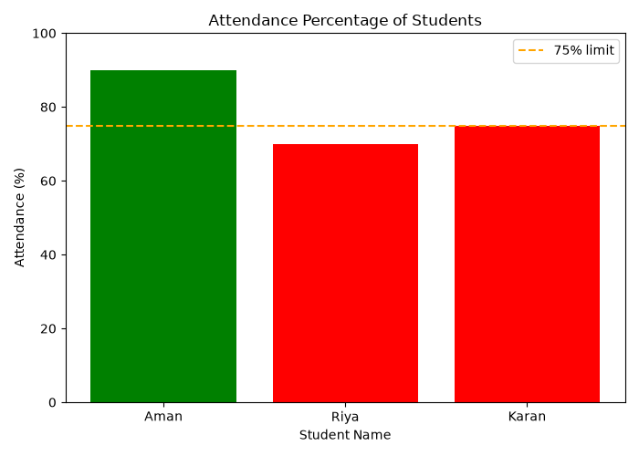
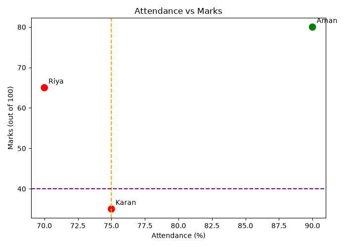

# PS 44 – Student Attendance & Performance Tracker

| | |
|---|---|
| **Name** | Vanshika Vishwakarma |
| **Enrollment No.** | RU-26-01920 |
| **University** | Rungta International Skills University |
| **School / Program** | School of Information Technology – Bachelor of Computer Application (BCA), 1st Year |
| **Language** | Python 3 |
| **Libraries** | Pandas, Matplotlib |

## Problem Statement
Analyse student attendance and marks from a CSV file to calculate attendance percentage,
identify students at risk and present the results with charts.

**CSV columns:** `Name, Classes_Held, Classes_Attended, Marks` (marks out of 100)

**At Risk rule:** a student is **At Risk** if attendance is **below 75%** or marks are **below 40**.

## Features
- Loads the CSV file using **Pandas** and cleans invalid rows (non-numeric values, attended greater than held,
  held 0 or less, negative values, marks outside 0–100, missing name, missing file or column)
- Calculates attendance % = `Classes_Attended / Classes_Held * 100` using Pandas columns
- Uses **boolean filtering** to find At Risk students and calculates average attendance and average marks
- Shows two **Matplotlib** charts with title and labels: a bar chart and a scatter chart (Attendance vs Marks)
- Simple menu: `1` Report, `2` Summary and charts, `3` Exit

## Requirements Covered
| # | Bare minimum requirement | Done in |
|---|--------------------------|---------|
| 1 | Python 3 solution in one `.py` file, run from the console | `attendance_tracker.py` |
| 2 | Load CSV with Pandas and clean invalid rows | `load_and_clean()` |
| 3 | Attendance percentage using Pandas columns | `df['Attendance_%']` |
| 4 | Boolean filtering for At Risk students and averages | `df[df['At_Risk']]`, `.mean()` |
| 5 | At least two Matplotlib charts with title and labels | `show_summary()` |

## How to Run
1. Install the libraries:
   ```
   pip install pandas matplotlib
   ```
2. Keep `attendance_tracker.py` and the CSV files in the same folder.
3. Run the program with a CSV file name:
   ```
   python attendance_tracker.py students.csv
   ```
   (If no file name is given, `students.csv` is used.)
4. At the menu type `1`, `2` or `3` and press Enter.
   > Type the **file name in the command**, not at the menu prompt – the menu accepts only 1, 2 or 3.

## Test Cases
Run each test with its own CSV file. Full details and output screenshots are in **`testcases.pdf`**.

| # | Type | Command | Menu | Expected output |
|---|------|---------|------|-----------------|
| 1 | Normal input | `python attendance_tracker.py test_case_1_normal.csv` | 1 | Aman 90.00% / Marks 80 / OK<br>Riya 70.00% / Marks 65 / At Risk (attendance below 75%)<br>Karan 75.00% / Marks 35 / At Risk (marks below 40) |
| 2 | Boundary / minimum input | `python attendance_tracker.py test_case_2_boundary.csv` | 1 | Neha 75.00% / Marks 40 / OK |
| 3 | Invalid input | `python attendance_tracker.py test_case_3_invalid.csv` | 1 | Row 1 skipped: attended (45) cannot exceed held (40).<br>Row 2 skipped: invalid Marks 'abc'.<br>No valid data to analyse. |
| 4 | Different valid scenario | `python attendance_tracker.py test_case_4_valid.csv` | 2 | Average attendance: 78.33% / Average marks: 60.00<br>At Risk students: 2 (Riya, Karan)<br>Bar chart and scatter chart displayed |

**Result:** all 4 test cases passed.

## Charts (Test Case 4)



## Repository Files
| File | Description |
|------|-------------|
| `attendance_tracker.py` | Complete Python source code |
| `README.md` | Project description and instructions (this file) |
| `testcases.pdf` | The 4 test cases with expected output and screenshots |
| `PS44_Project_Report.pdf` | Detailed project report |
| `students.csv` | Sample input data |
| `test_case_1_normal.csv`, `test_case_2_boundary.csv`, `test_case_3_invalid.csv`, `test_case_4_valid.csv` | CSV files for the 4 test cases |
| `bar_chart_attendance.png`, `scatter_attendance_vs_marks.png` | Charts created by the program |
| Project details image | Screenshot of the PS 44 problem statement from the Project Allocation PDF |

## Author
**Vanshika Vishwakarma** (RU-26-01920) – BCA 1st Year, Rungta International Skills University
